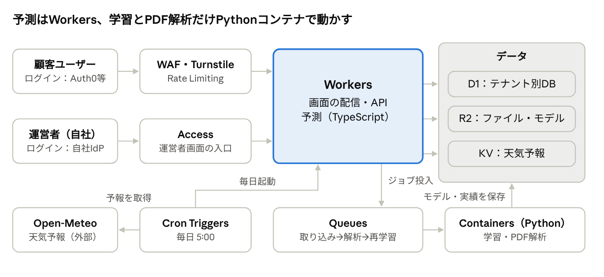
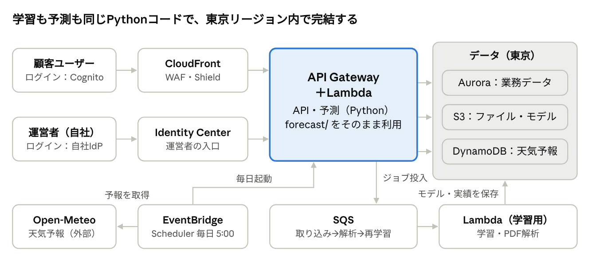

# 入電予測SaaS 構成仕様書（Cloudflare版・AWS版）

作成日：2026年10月31日　作成者：佐藤

## 1. 概要と共通仕様

コールセンター向けに、天気予報と休日から日別の入電件数と必要オペレーター数を予測するマルチテナントSaaSとして提供する。機能・画面・API・データ構造は両案で共通とし、違いは実行基盤だけにする。

**前提となる変更点（両案共通）**

- 画面はStreamlitからWebアプリ（React等のSPA）に作り直す。Streamlitは1台のサーバーで動かす前提で、マルチテナントの認証や負荷分散に向かないため。
- 予測ロジック（特徴量作成・LightGBM）は現行の `forecast/` を土台にする。
- 学習は1テナントあたり数百〜数千行と小さく、数秒〜数十秒で終わる。

### 機能一覧

| 機能 | 内容 | 利用者 |
| --- | --- | --- |
| 週間予測・シフト | 天気予報を自動取得し、7〜14日先の件数・80%区間・必要人数を表示。気温と休日を画面で修正可能 | シフト担当 |
| 月間予測 | 平年気温で月の日別予測をカレンダー表示。気温シナリオ（平年±℃）を試せる | シフト担当・閲覧者 |
| 予測の記録と答え合わせ | 出した予測を保存し、実績が入ったら何日前の予測かごとの誤差を表示 | シフト担当 |
| 実績データの取り込み | 集計表PDF・CSVをアップロードすると解析して保存し、再学習を予約 | テナント管理者 |
| 会社休日の管理 | お盆・GW休業などを登録 | テナント管理者 |
| モデル管理 | 学習済みモデルの版、精度、採用状況を表示。新モデルは現行に勝った場合だけ自動採用 | テナント管理者 |
| 設定 | 天気予報の地点、平均処理時間・応答率などの人数計算条件 | テナント管理者 |
| ユーザー管理 | 招待、役割の変更、利用停止 | テナント管理者 |

### テナントと役割

| 役割 | できること |
| --- | --- |
| 運営者（自社） | テナントの作成・停止、障害対応。顧客データの閲覧は顧客の許可がある場合のみ |
| テナント管理者 | データ取り込み、休日・設定・ユーザー管理、モデル管理 |
| シフト担当 | 予測の閲覧・修正・記録、CSV出力 |
| 閲覧者 | 予測と精度の閲覧のみ |

### 主なデータ

| テーブル | 主な項目 |
| --- | --- |
| tenants | テナントID、名称、プラン、天気予報の地点 |
| users | ユーザーID、テナントID、メール、役割 |
| actuals | 日付、入電・応答・受付件数、休日、最高・最低気温 |
| company_holidays | 日付、名称 |
| forecast_logs | 記録日時、対象日、何日前の予測か、使った気温、予測値、区間、モデル版 |
| model_versions | 版、学習日時、学習データの最終日、精度、モデルファイルの保存先、状態（採用中・候補・廃止） |
| uploads | ファイル名、保存先、解析結果、取り込み件数 |
| audit_logs | 日時、ユーザー、操作、対象 |

### 主なAPI

| メソッドとパス | 内容 |
| --- | --- |
| `GET /api/forecast/weekly?days=7` | 予報を使った週間予測と必要人数 |
| `POST /api/forecast/simulate` | 画面で修正した気温・休日での再予測 |
| `GET /api/forecast/monthly?month=2026-12&shift=0` | 月間予測（平年気温＋シナリオ） |
| `POST /api/forecast-logs` / `GET /api/forecast-logs/evaluation` | 予測の記録 / 答え合わせ |
| `POST /api/uploads` | 実績ファイルの取り込み（非同期） |
| `GET/POST/DELETE /api/holidays` | 会社休日 |
| `GET /api/models` / `POST /api/models/retrain` | モデル一覧 / 再学習の実行 |
| `GET/PUT /api/settings` | 地点・人数計算条件 |

### 定期処理

| 処理 | タイミング | 内容 |
| --- | --- | --- |
| 天気予報の取得 | 毎日 5:00 | 地点ごとに16日先までの予報と直近7日の気温を取得してキャッシュ（地点単位で共有し、テナント数だけ呼ばない） |
| 予測の更新 | 予報取得の後 | 各テナントの週間予測を計算して保存 |
| 再学習 | 実績取り込みの後 | 候補モデルを学習し、直近3か月のバックテストと交差検証で現行と比較。勝てば採用 |
| 答え合わせ | 実績取り込みの後 | 記録済みの予測と実績を照合して精度を更新 |

## 2. Cloudflare版

画面・API・予測はCloudflare Workersで動かし、Workersで動かないLightGBMの学習とPDF解析だけをCloudflare ContainersのPythonで行う。サーバーを公開せず、パッチを当てる対象がほぼない構成になる。

### 使うサービス

| 役割 | サービス | 備考 |
| --- | --- | --- |
| 画面の配信 | Workers（静的アセット） | SPAを配信 |
| API・予測 | Workers（TypeScript） | 予測は学習済みモデルをJSONで読み込み、木をたどって計算 |
| 学習・PDF解析 | Containers（Python） | 現行の `forecast/` と `scripts/extract_pdf.py` をそのまま使う |
| 非同期ジョブ | Queues | 取り込み→解析→再学習→答え合わせを順に流す |
| 定期実行 | Cron Triggers | 毎日の天気予報取得と予測更新 |
| 業務データ | D1（SQLite） | テナントごとに1つのD1データベースを分ける。共通情報（テナント一覧・ユーザー）は別のD1 |
| ファイル | R2 | アップロードされたPDF・CSV、モデルファイル |
| キャッシュ | KV | 地点ごとの天気予報 |
| 防御 | WAF、Rate Limiting、Turnstile | ログイン画面はボット対策を入れる |
| 運営者画面 | Cloudflare Access | 自社のIdPでログインした社員だけが入れる |
| 顧客のログイン | 外部の認証サービス（Auth0等） | 顧客企業のSSO（SAML/OIDC）に対応しやすい。Workersでトークンを検証 |
| ログ | Workers Logs、Logpush | 監査ログは別途D1にも保存 |

### 学習と予測の分担

1. 実績が取り込まれると、Queues経由でContainersの学習ジョブを起動する。
2. ジョブはD1からそのテナントの実績を読み、学習・検証して、モデルをJSON（LightGBMの木の定義）でR2に保存する。
3. WorkersはそのJSONを読み込んで予測する。画面で気温を変えたときの再予測も数ミリ秒で返せる。

### 制約と対応

| 制約 | 対応 |
| --- | --- |
| WorkersではLightGBMなどPythonの機械学習ライブラリが動かない | 学習はContainers、予測はTypeScriptで再実装 |
| 特徴量作成をPythonとTypeScriptの2か所に持つことになり、ずれると予測が狂う | 同じ入力で両者の予測が一致するかを確かめるテストをデプロイの条件にする |
| Containersは比較的新しいサービス | 提供状況・料金・制限を導入前に確認。使えない場合は学習だけ別基盤（AWS Lambda等）に置く |
| D1・R2の保存場所を日本国内に限定できるかは契約プラン次第 | 顧客が国内保管を求める場合は、Cloudflareに確認してから採用を決める |
| D1は1データベースあたりの容量に上限がある | 日別・時間帯別の実績なら数十年分でも十分小さい。テナント別に分けるので全体の上限には当たらない |

利用者の操作はすべてWorkersで返し、学習とPDF解析だけがQueues経由でContainersに回る。

## 3. AWS版

東京リージョン（ap-northeast-1）で、APIと学習をLambdaのPythonで動かす。現行のPythonコードを学習と予測の両方でそのまま使え、顧客データを国内に置ける。

### 使うサービス

| 役割 | サービス | 備考 |
| --- | --- | --- |
| 画面の配信 | S3＋CloudFront | SPAを配信。S3は非公開にしCloudFront経由のみ許可 |
| API・予測 | API Gateway＋Lambda（Pythonコンテナイメージ） | FastAPIでAPIを作り `forecast/` をそのまま呼ぶ |
| 学習・PDF解析 | Lambda（同じイメージ） | 学習は数秒〜数十秒で、Lambdaの実行時間上限（15分）に収まる |
| 非同期ジョブ | SQS | 取り込み→解析→再学習→答え合わせ |
| 定期実行 | EventBridge Scheduler | 毎日の天気予報取得と予測更新 |
| 業務データ | Aurora Serverless v2（PostgreSQL） | 全テーブルに tenant_id を持たせ、行レベルセキュリティで他テナントの行を読めなくする |
| ファイル | S3 | アップロードファイルとモデル。テナントごとにプレフィックスを分ける |
| キャッシュ | DynamoDB（TTL付き） | 地点ごとの天気予報 |
| 防御 | AWS WAF、Shield Standard | CloudFrontとAPI Gatewayの前段 |
| ログイン | Cognitoユーザープール | 顧客企業のSSO（SAML/OIDC）と連携可能 |
| 秘密情報・暗号化 | Secrets Manager、KMS | DB・S3は保存時暗号化 |
| 監視・監査 | CloudWatch、CloudTrail、GuardDuty、Security Hub、AWS Config | 設定ミスの自動検出まで含める |
| アカウント管理 | AWS Organizations | 本番・検証・監査ログでアカウントを分ける |

### 学習と予測の分担

1. 実績が取り込まれると、SQS経由で学習用Lambdaを起動する。
2. 学習したモデルをS3に保存し、精度と一緒に model_versions に登録する。
3. APIのLambdaが同じPythonコードで予測する。特徴量作成は1か所だけで済む。

### 制約と対応

| 制約 | 対応 |
| --- | --- |
| 設定項目が多く、IAMやS3の公開設定のミスが情報漏えいの主な原因になる | 構成をすべてコード化（TerraformまたはCDK）し、S3のパブリックアクセスをアカウント単位で禁止。Security Hubで常時点検 |
| Lambdaの初回起動が遅い（LightGBM入りイメージで数秒） | 画面で使うAPIにだけ最小限の常時起動（Provisioned Concurrency）を設定 |
| Auroraは使わない時間も最低料金がかかる | 初期は最小容量で運用。顧客数が少ないうちは単一のRDS PostgreSQLでもよい |

形はCloudflare版と同じで、中央のAPIと学習の両方がPythonになるため、特徴量作成を1か所で管理できる。画面のSPAはCloudFront経由でS3から配信する。

## 4. 比較と推奨

方針どおりCloudflare版を採用してよい。ただし「顧客がデータの国内保管を求めるか」と「Containersが使えるか」の2点を導入前に確認し、どちらかで詰まったら、入口だけCloudflare、中身はAWS東京という組み合わせに切り替える。

| 観点 | Cloudflare版 | AWS版 |
| --- | --- | --- |
| 現行コードの再利用 | 学習はそのまま。予測と特徴量作成はTypeScriptで作り直し | 学習も予測もそのまま |
| データの保存場所 | 国内限定は契約次第（要確認） | 東京リージョンに固定できる |
| 攻撃されうる範囲 | 公開サーバーがなく、WAFが標準で前に立つ | 設定次第。項目が多くミスの余地が大きい |
| テナント分離 | テナントごとに別データベース（強い） | 同じデータベースで行ごとに分離 |
| 運用の手間 | 少ない | 多い（アカウント、IAM、監視サービスの管理） |
| 費用の構造 | 利用量に比例し、顧客が少ないうちは安い | Auroraなど常時かかる固定費がある |
| 実績と情報の多さ | Containersなど新しい部分がある | 事例・認証（ISMAP等）・人材が豊富 |

「AWSはセキュリティリスクが高い」の実態は、AWS自体の弱さより、設定ミスからの事故が多いことによる。Cloudflareでも認証やテナント分離を誤れば同じように漏れるので、次節の要件はどちらでも必須とする。費用の金額は利用見込みが決まってから見積もる。

## 5. セキュリティ要件（共通）

コールセンターの業務データを預かるため、他テナントのデータが見える事故を最優先で防ぐ。現状のデータは日別の件数と気温で個人情報を含まないが、含む前提で設計する。

| 項目 | 要件 | Cloudflare版 | AWS版 |
| --- | --- | --- | --- |
| テナント分離 | 全APIでトークンのテナントIDを強制し、利用者が指定したIDを信用しない。他テナントへのアクセスを試みる自動テストを持つ | テナント別D1 | 行レベルセキュリティ |
| 認証 | 多要素認証を必須化できること。顧客企業のSSOに対応 | 外部認証サービス | Cognito |
| 運営者のアクセス | 顧客データの閲覧は顧客の許可と期限付き。すべて監査ログに残す | Cloudflare Access | IAM Identity Center |
| 暗号化 | 通信はTLS 1.2以上、保存時も暗号化 | 標準で有効 | KMSで有効化 |
| 秘密情報 | コードやリポジトリに書かない | WorkersのSecrets | Secrets Manager |
| アップロード | 拡張子と中身でPDF・CSVだけ受け付け、サイズ上限を設ける。解析は隔離した環境で行う | Containers | Lambda |
| 監査ログ | ログイン、データ取り込み、設定変更、出力を記録し、1年以上保管 | D1＋Logpush | CloudTrail＋DB |
| バックアップ | 過去30日の任意時点に戻せること。復旧手順を年一回試す | D1のTime Travel | Auroraの自動バックアップ |
| 解約時 | データを書き出して渡せ、削除したことを証明できる | D1ごと削除 | テナントの行とS3プレフィックスを削除 |
| 脆弱性対応 | 依存ライブラリの自動更新通知、リリース前の脆弱性診断 | 共通 | 共通 |

## 6. 未確定事項と次のステップ

- [ ] 想定顧客がデータの国内保管を求めるかを確認し、求めるならCloudflareに国内限定の可否と契約条件を問い合わせる
- [ ] Cloudflare Containersの提供状況・料金・制限を確認し、現行の学習コードを動かしてみる
- [ ] LightGBMのモデルをJSONで書き出し、TypeScriptの予測結果がPythonと一致するかを検証する
- [ ] 顧客のログインに使う認証サービスを決める（SSOの要否、利用者数あたりの料金）
- [ ] 料金プランと想定顧客数を決め、両案の月額費用を見積もる
- [ ] 画面をStreamlitからSPAへ作り直す（デモ画面をたたき台にする）
- [ ] 利用規約・プライバシーポリシー・データの取り扱いに関する契約書の雛形を用意する
